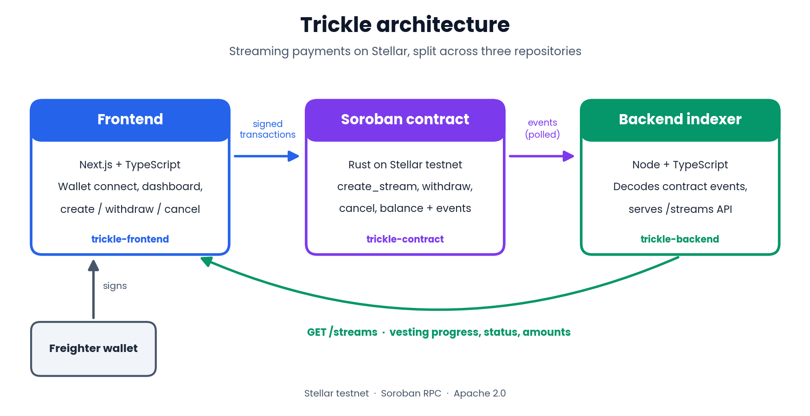

# Trickle Contract

Soroban smart contract powering Trickle — a streaming payments protocol on Stellar. Instead of paying in a lump sum, senders lock funds that vest continuously to a recipient over a set duration.

## Functions
- `create_stream(sender, recipient, token, amount, duration)` — locks funds, starts the stream
- `balance(stream_id)` — amount currently available to withdraw
- `withdraw(stream_id)` — recipient claims vested funds
- `cancel(stream_id)` — sender cancels early; recipient keeps vested amount, sender gets the rest back

Every state-changing call emits an event so off-chain systems (like [trickle-backend](https://github.com/trickle-lab/trickle-backend)) can track activity without polling storage directly.

## Status
Deployed and tested live on Stellar testnet. Core logic (create/withdraw/cancel/balance) works end to end, and the unit tests run in CI with `cargo test`.

## Setup
See [CONTRIBUTING.md](./CONTRIBUTING.md).

## Part of Trickle
- [trickle-contract](https://github.com/trickle-lab/trickle-contract) (this repo)
- [trickle-backend](https://github.com/trickle-lab/trickle-backend)
- [trickle-frontend](https://github.com/trickle-lab/trickle-frontend)

## License
Apache License 2.0
## Live on Stellar testnet

- Contract: [`CBM2KGHZZOHJ44GSHJWHY4YKTKOH3VUBBWZCXIG2NT2ONGBP6ANJMPGR`](https://stellar.expert/explorer/testnet/contract/CBM2KGHZZOHJ44GSHJWHY4YKTKOH3VUBBWZCXIG2NT2ONGBP6ANJMPGR)
- Example `create_stream`: [transaction](https://stellar.expert/explorer/testnet/tx/ecc5ee89fc2bb6c5ac36172662b5addeaf4ec42d0547e9de892d5f3c3510a42d)
- Example `withdraw`: [transaction](https://stellar.expert/explorer/testnet/tx/PASTE_WITHDRAW_HASH)
- Example `cancel`: [transaction](https://stellar.expert/explorer/testnet/tx/PASTE_CANCEL_HASH)
